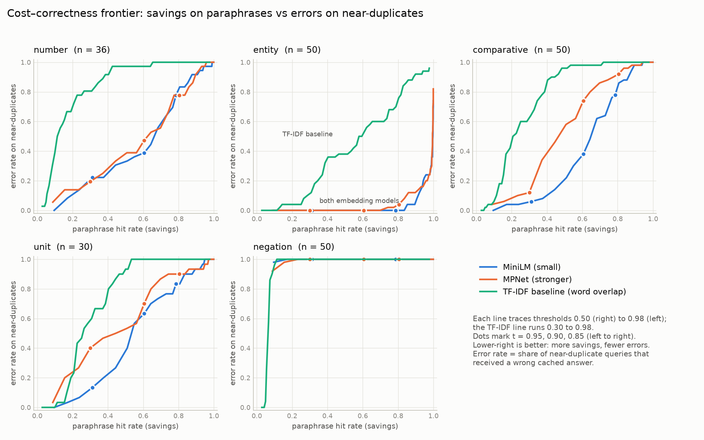
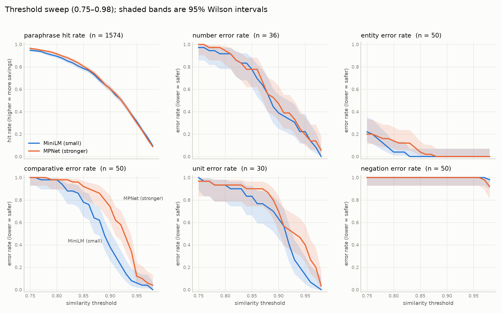
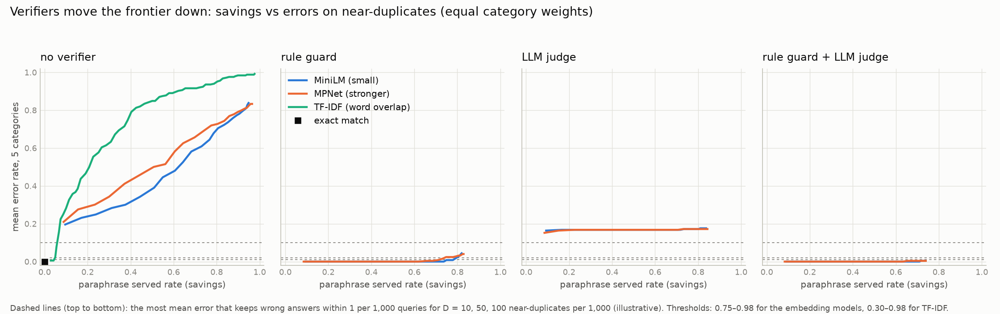

# Mapping the cost–correctness frontier of semantic caching

A semantic cache answers a new question with a stored answer when the question is
*similar enough* to one it has seen before: embed the query, find the nearest cached
question, and serve its answer if the cosine similarity is above a threshold. Every hit
saves an LLM call, but a question that only *looks* the same ("Which of A or B **is not**
X?") gets the wrong answer.

We measure that trade-off: how many calls a semantic cache saves on genuine rephrasings,
how many wrong answers it serves on near-duplicates, as the threshold changes, whether a
verifier makes a safe setting possible, and whether the answer holds on real traffic.

## The one command

```powershell
python reproduce.py
```

This regenerates every result and figure from the committed data in about a minute on a
laptop, **with no GPU** (the LLM judge's verdicts are reused from `results/`), then checks
that the numbers match the committed ones and prints `All main results reproduced.`

Setup (Windows PowerShell, Python 3.12):

```powershell
py -3.12 -m venv .venv
.\.venv\Scripts\Activate.ps1
pip install -r requirements.txt
```

## Recommendation

**A similarity threshold is only safe for the traffic it was tuned on.** On our synthetic
mix (genuine rephrasings plus one-word edits), rule guard + LLM judge is safe from threshold
0.50 and saves about 226 calls per 1,000. On **real** TriviaQA questions, that same setting
serves 28 wrong answers per 1,000, because real traffic is full of *different questions on
the same topic*, which neither verifier was built for. A cross-encoder trained on duplicate
questions cuts that to 16, but nothing we tried, even tuned on the real traffic itself, stays
within 1 wrong answer per 1,000 below threshold **0.98**, where the cache serves just 8–11
correct answers per 1,000.

So: use a semantic cache with a very high threshold (0.95–0.98) and both verifiers, expect
savings of a few percent unless users really repeat themselves, and measure the error rate
on your own traffic before lowering the threshold.

## Experimental setup

| | |
|---|---|
| **Cache** | 787 TriviaQA questions with answers (`data/source_questions.json`, minus `data/excluded_ids.txt`) |
| **Genuine rephrasings** | 1,574 paraphrases, 2 per cached question, reviewed by hand (`data/paraphrases.json`) |
| **Near-duplicates** | 216 queries with a different answer: number 36, entity 50, comparative 50, unit 30, negation 50 (`data/adversarial.csv`) |
| **Real traffic** | 2,000 random TriviaQA questions from the same filtered pool, sent to a cache of the other 60,625 (`simulation/real_traffic.py`) |
| **Varied** | similarity threshold (0.50–0.98, steps of 0.01); embedding model (all-MiniLM-L6-v2, all-mpnet-base-v2); verifier (none, rule guard, LLM judge, both, cross-encoder, rule guard + cross-encoder) |
| **Held fixed** | cache contents, query sets, answer scorer, normalised embeddings, greedy decoding for every LLM step; each adversarial category is tested against its own cache |
| **Baselines** | exact-match cache; TF-IDF word-overlap cache (0.30–0.98); embedding + word-overlap gate |
| **Metrics** | paraphrase hit rate (savings); error rate per category = share of near-duplicates served a wrong answer; per 1,000 queries: calls saved and wrong answers |
| **Error bars** | 95% Wilson intervals on every rate; bootstrap (1,000 resamples) for the safe threshold |
| **Checks against hand labels** | answer scorer and LLM judge vs 57 hand-labelled pairs; answer scorer on real traffic vs 60 more; paraphrase review vs a blind second reviewer (50 items) |

**Safe threshold:** the threshold that saves the most calls while serving at most
**1 wrong answer per 1,000 queries**. For the synthetic test we assume 300 genuine
rephrasings and D = 10, 50 or 100 near-duplicates per 1,000 (illustrative, categories
weighted equally); the real-traffic test needs no assumption.

## Key findings

1. **No threshold alone is safe.** Even at 0.98, MiniLM serves the wrong answer to 98% of
   negation queries (MPNet 92%), while saving only about 9% of paraphrases. "X" and
   "not X" sit almost on top of each other in embedding space.
2. **The stronger model is not safer.** MPNet makes more errors than MiniLM on comparative
   changes at the same paraphrase hit rate, and on unit changes over most of the curve.
3. **Similarity cannot separate the two kinds of query.** Number, unit, comparative and
   negation edits share *more* words with their cached question (median TF-IDF overlap
   0.81–0.93) than genuine paraphrases do (0.68); only entity swaps share fewer (0.60). TF-IDF alone, and an embedding + word-overlap gate, both top out at
   13–17 safe calls saved per 1,000.
4. **The LLM judge alone is not enough.** Qwen2.5-1.5B accepts 84% of negation pairs and
   rejects 14% of genuine paraphrases (agreement with the scorer on 1,792 pairs: κ = 0.49).
5. **On synthetic traffic, rule guard + LLM judge is safe at every D**, from threshold
   0.50: about **226 calls saved per 1,000** (bootstrap 95% range 218–231 at D = 10) with
   0.04–0.40 wrong per 1,000. At 0.50, 99.9% of paraphrases are already hits, so no lower
   threshold could save more.
6. **On real traffic, that setting fails.** It serves **28 wrong answers per 1,000**
   (label-corrected); the rule guard alone at its synthetic-safe 0.61 serves 218. The errors
   are same-topic questions such as "In which year did Shakespeare die?" answered from "How
   old was Shakespeare when he died?". Only threshold 0.98 meets the budget.
7. **A cross-encoder is the best verifier, but not enough.** `cross-encoder/quora-distilroberta-base`
   reads both questions together. On the synthetic test it alone is safe from 0.50 and saves
   267 calls per 1,000, more than our hand-built rule guard. On real traffic, rule guard +
   cross-encoder serves 16 wrong answers per 1,000 at 0.50, about 45% fewer than rule guard +
   judge. Its cut-off chosen on synthetic data (0.05) is the worst one for real traffic
   (48 wrong per 1,000): another case of synthetic tests rewarding settings that fail.
8. **No verifier makes real traffic safe below 0.98.** Even choosing the cross-encoder's
   cut-off and the threshold on the real traffic itself (an upper bound, not a fair test),
   staying within 1 wrong per 1,000 needs t = 0.98 (9–10 correct per 1,000); a budget of
   5 wrong per 1,000 would allow 65–75.
9. **The answer scorer needed checking twice.** On our own data it agrees with hand labels on
   57/57 pairs (κ = 1.0). On real traffic, where the same answer is often written differently
   ("Disney" vs "Walt Disney"), it agrees on only 43/59 (κ = 0.49); a lenient version that
   accepts one answer inside the other agrees on 56/59 (κ = 0.89) and is used there.
10. **Our samples cannot certify the budget.** With 0 errors in 30–50 items per category,
   the upper ends of the 95% intervals still allow more than 1 wrong answer per 1,000, so
   the safe thresholds are point estimates.

| Setup | Test | Safe threshold | Calls saved per 1,000 | Wrong per 1,000 |
|---|---|---|---:|---:|
| Either model, no verifier | synthetic, D = 10 | none | 0 | – |
| Either model + LLM judge | synthetic, D = 10 | none | 0 | – |
| MiniLM + rule guard | synthetic, D = 10 | 0.61 | 255 | 0.96 |
| MiniLM + rule guard + judge | synthetic, D = 10 | 0.50 | 226 | 0.04 |
| TF-IDF baseline | synthetic, D = 10 | 0.94 | 17 | 0.78 |
| MiniLM + rule guard + judge at 0.50 | **real traffic** | not safe | 151 correct | 28 |
| MiniLM + rule guard + judge at 0.95 | **real traffic** | not safe | 42 correct | 2.5 |
| MiniLM + rule guard + judge | **real traffic** | 0.98 | 8 correct | 0.74 |
| MPNet + rule guard | **real traffic** | 0.98 | 10 correct | 0.66 |
| Either model, cross-encoder alone | synthetic, D = 10 | 0.50 | 267 | ≤ 1 |
| MiniLM + rule guard + cross-encoder at 0.50 | **real traffic** | not safe | 107 correct | 16 |
| Best cross-encoder setting, tuned on real traffic | **real traffic** | 0.98 | 9–10 correct | 0.66–0.74 |

Full tables: `results/safe_thresholds.csv`, `results/bootstrap_safe_thresholds.csv`,
`results/real_traffic.csv`, `results/real_traffic_label_check.json`, `results/cross_encoder.csv`.

### Figures

| | |
|---|---|
|  | **Frontier per category:** savings vs errors, one line per model and the TF-IDF baseline |
|  | **Threshold sweep:** paraphrase hit rate and each error rate, with 95% Wilson bands |
|  | **Verifiers:** the frontier with each verifier, against the error budget |

## Repository map

| Folder | What is in it |
|---|---|
| `data/` | source questions, paraphrases, adversarial set, hand labels, embeddings; how they were built is in [`data/data_source_note.md`](data/data_source_note.md) |
| `paraphrase/` | paraphrase generation with Qwen2.5-1.5B-Instruct (GPU) and the build step |
| `embeddings/` | `embed.py`: encodes all 2,701 texts with both models (GPU) |
| `simulation/` | `simulate.py` (sweep), `baseline.py`, `plots.py`, `rule_guard.py` + `verify.py` (verifiers), `costs.py` (safe thresholds), `bootstrap.py`, `hybrid_gate.py`, `real_traffic.py`, `cross_encoder.py`, `hand_labels.py`, `real_labels.py` |
| `results/` | every CSV and figure produced by `reproduce.py` |

### Rebuilding from scratch (needs a GPU)

`reproduce.py` starts from the committed paraphrases, embeddings and judge verdicts. To
rebuild those too, run in order: `data/build_source_questions.py`,
`paraphrase/generate_paraphrases.py`, `paraphrase/retry_paraphrases.py`, the hand review,
`paraphrase/build_paraphrases.py`, `embeddings/embed.py`, then delete
`results/judge_cache.jsonl` and `results/real_traffic_judge.jsonl`, run
`python simulation/verify.py`, `python simulation/real_traffic.py build` and
`python simulation/cross_encoder.py score`, and finally `reproduce.py`.

## Limitations

- The rule guard targets exactly the edits we used to build the near-duplicates, so its
  synthetic results are a best case; real traffic shows how much that matters.
- The synthetic traffic mix (300 rephrasings and D near-duplicates per 1,000) is assumed.
- 124 of the 216 near-duplicates were written by us, and each category has 30–50 items.
- Real TriviaQA traffic contains almost no true repeats, so it understates the savings a
  product with returning users would see; its safe point rests on about 1–2 wrong answers
  in 2,000 queries.
- Both embedding models were trained on data that includes TriviaQA, which may make
  paraphrase matching look easier than on new questions.
- More in [`data/data_source_note.md`](data/data_source_note.md), section 8.

## Data and models

- TriviaQA: Joshi et al., ACL 2017 (`mandarjoshi/trivia_qa`, `unfiltered.nocontext`); licence
  listed as unknown, used for this course project only.
- sentence-transformers/all-MiniLM-L6-v2 and all-mpnet-base-v2 (Apache-2.0).
- Qwen/Qwen2.5-1.5B-Instruct (Apache-2.0), for paraphrases and as the LLM judge.
- cross-encoder/quora-distilroberta-base (Apache-2.0, 82.1M parameters, trained on Quora
  duplicate questions; outputs a 0–1 score for how likely two questions are duplicates), as
  the cross-encoder verifier.
